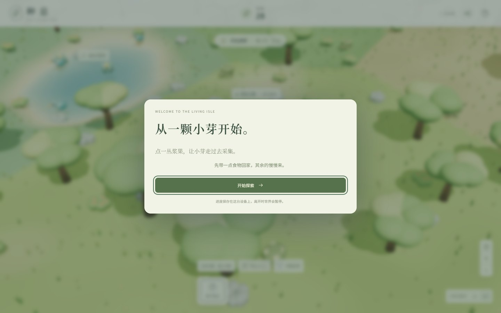
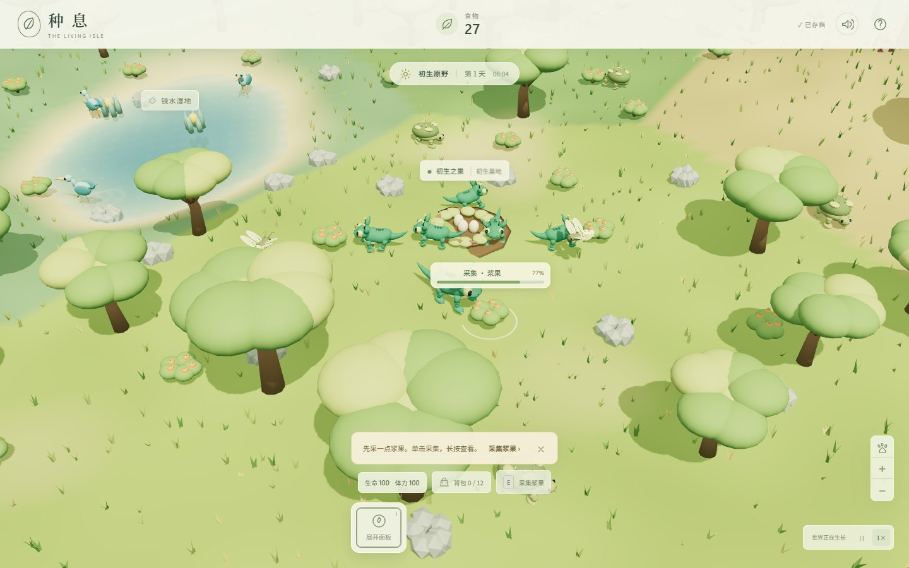

# 种息 · 初生之岛

一款以《孢子》生物阶段为灵感的单人网页游戏。操控「小芽」探索岛屿，采集、捕猎、带回资源，进化身体，再和同伴营造家园。

当前版本 4.3，围绕长期家园、短途远征与身体进化构成可玩循环。

## 游戏画面

本地规则模式实机截图，拍摄于 2026-10-12；未调用付费模型。





## 已实现玩法

- 岛屿探索、寻路采集、返巢入库、捕猎与同伴分工。
- 身体部件进化、孵育、建筑施工与家园成长。
- 天气、昼夜、潮汐、涉水和游泳，以及会移动和捕猎的野生动物。
- 潮汐考验、短途远征、后裔时代与第二座岛屿的任务循环。
- IndexedDB 本机存档、导入导出、暂停，以及日夜/远征配乐和动作音效。

| 操作 | 输入 |
| --- | --- |
| 移动 / 奔跑 | WASD、方向键 / Shift；也可点击地面 |
| 互动、采集 | E；点击资源或生物，长按查看详情 |
| 返巢 / 召唤守卫 | H / Q |
| 打开面板 | 1–5；6 打开已解锁的远征 |
| 镜头 / 暂停 | 右键拖动、滚轮、中键平移 / 空格 |

## 本地运行

需要 Node.js 24 和 npm，浏览器需要支持 WebGL。首次安装依赖需要网络。

```sh
npm ci --ignore-scripts
npm run dev
```

打开 <http://127.0.0.1:5196/>。命令同时启动 Vite 前端和本机生态服务；服务默认是无需密钥的规则模式。生态服务使用 Node 内置 SQLite，开发数据写入本地 `.ecology/`，不要将该目录作为源码提交。

如环境中曾配置模型模式，可在 PowerShell 启动前设置 `$env:ECOLOGY_MODE='rule'`。模型功能是可选项，按 [.env.example](.env.example) 配置服务端环境变量；示例文件不会自动加载，密钥不应进入浏览器或 Git。

```sh
npm run build    # 生成 dist/
npm run preview  # http://127.0.0.1:4186/
npm test         # 项目已有规则测试
```

2026-10-12 已在 Windows / Node.js 24.15.0 的隔离副本完成依赖安装、开发启动、采集操作和生产构建。本次未验证线上服务、真实模型调用或完整通关。

## 技术栈与目录

JavaScript、Three.js、Vite；Node.js / SQLite 提供可选生态服务。

- `src/core/`：世界状态、导航、模拟、规则和存档。
- `src/view/`、`src/ui/`：3D 场景与操作界面。
- `server/ecology/`：带配额和去重账本的生态服务。
- `public/models/`、`art/`：GLB、Blender 源文件和资产清单。
- `public/audio/`：运行时音频与生成记录。
- [当前玩法说明](roadmap/15-simpler-first-hour.md)、[远征与身体进化](roadmap/13-home-expeditions-and-adaptations.md)、[声音制作](roadmap/16-island-audio.md)。

## 当前限制

当前是单人生物阶段原型，未实现细胞、部落、文明、太空阶段或自由拖拽身体编辑器。建造采用有限巢区中的选项，远征地图和委托种类有限。完整生态食物网、自由摆放建筑和移动设备性能分档仍需继续开发。历史部署文档不代表线上服务当前可用。

## 素材来源

仓库中的模型与场景由项目 Blender 脚本和程序化网格制作，可对照 `art/*manifest.json` 与 `scripts/generate*_models.py`。运行时不需要 Blender。

配乐与音效的本地生成版本、提示词、种子、处理步骤和哈希记录在 [音频清单](public/audio/manifest.json) 与 `art/audio/sound-design.json`。记录所用生成器为 [ACE-Step 1.5](https://github.com/ace-step/ACE-Step-1.5)（生成器代码 MIT）和 [Dasheng-AudioGen](https://github.com/xiaomi-research/dasheng-audiogen)（生成器代码 Apache-2.0）；模型代码和权重不随游戏发布。生成器许可不等于为游戏音频另行指定了许可证。

## 许可证

本项目自有代码采用 [MIT 许可证](LICENSE)。素材范围与来源见 [ASSETS.md](ASSETS.md)；第三方依赖及素材保留原有条款，不因代码 MIT 而被重新授权。

本仓库从已清理的当前文件建立独立 Git 历史；原私库与原工作区保留。

## Languages

The current First Island game supports English and Simplified Chinese. It selects the first supported language in your browser preferences (English is the fallback). Use the **English / 简体中文** selector in the welcome screen, top bar, or Help to switch instantly. The choice is stored separately from journey saves under `zhongxi-isle-language-v1`; blocked storage still permits switching for the current session. Language changes preserve your journey and simulation.

The archived `legacy/` version remains an original-version compatibility path and is not part of the current game's bilingual interface.
